<p align="center">
  
</p>

<p align="center">
  
</p>

<p align="center">
  <a href="https://thashmikab.github.io/My_Journey/"><b>🌊 Explore my research journey →</b></a>
</p>

```python
class Thash:
    def __init__(self):
        self.name = "Thashmika Bandara"
        self.goes_by = "Thash"
        self.avatar = "assets/avatar.svg"   # ↑ that's me, waving hello
        self.role = [
            "PhD Candidate, Electrical & Electronic Engineering @ City St George's, University of London",
            "Visiting Lecturer (Data Science) @ York St John University, London",
        ]
        self.based_in = "London, UK"
        self.thesis = "Optimisation of Critical Material Usage in Renewable Energy Systems"

        self.current_focus = [
            "Dynamic LCA of critical materials (copper, zinc, lead)",
            "Multi-objective optimisation (NSGA-II) of UK renewable roadmaps to 2050",
            "Offshore wind layout & supply-chain modelling",
            "IoT sensing → optimisation pipelines",
        ]

        self.toolbox = {
            "optimisation": ["pymoo", "NSGA-II", "SPEA2", "MOEA/D", "PyWake", "TopFarm"],
            "life_cycle_assessment": ["Brightway 2.5", "ecoinvent 3.9.1", "SimaPro", "ReCiPe 2016 (18 categories)"],
            "data": ["Python", "Pandas", "NumPy", "PySpark", "scikit-learn", "Matplotlib", "MATLAB"],
            "iot": ["ESP32", "MQTT", "sensors & embedded C"],
            "workflow": ["Google Colab", "Git", "LaTeX"],
        }

        self.ask_me_about = [
            "Why a wind turbine's copper matters as much as its blades",
            "Pareto fronts",
            "Getting SimaPro to behave",
        ]

        self.publications = {
            "IEEE SusTech 2026": "Net Environmental Impact Classification of Cu, Zn and Pb in UK Offshore Wind",
            "E3S Web of Conf. 2025": "Comparative LCA of Cu, Zn and Pb in Offshore Wind",
            "ICEE 2024": "Environmental Impacts from Copper in Solar and Offshore Wind",
        }

        self.contact = {
            "email": "thashmikab@gmail.com",                       
            "linkedin": "https://www.linkedin.com/in/thashmika-bandara-kmtr/",  
            "scholar": "https://scholar.google.com/citations?hl=en&user=qhvuVRcAAAAJ",
            "website": "https://thashmikab.github.io/My_Journey/",
        }

        self.motivation = "Making the energy transition cleaner, all the way down to the materials."
        self.fun_fact = "An offshore wind farm is just a very large multi-objective problem standing in the sea."


me = Thash()
```

### 🌊 Featured work

| Project | What it shows |
|---|---|
| [paretolens](https://github.com/Thashmikab/paretolens) | A Python package for picking solutions from multi-objective Pareto fronts. It finds knee points and runs TOPSIS ranking, then writes an interactive HTML report straight from pymoo, CSV or Excel |
| [offshore-wind-layout-cable-tradeoff](https://github.com/Thashmikab/offshore-wind-layout-cable-tradeoff) | Wind farm layout optimisation with PyWake/TopFarm and NSGA-II, trading energy yield against cable cost and environmental impact |
| [london-smart-meter-analysis](https://github.com/Thashmikab/london-smart-meter-analysis) | Large-scale PySpark analysis of London smart meter data, testing whether time-of-use tariffs saved money and carbon, and clustering households by how much load they can shift |
| QZ-NSGA-II | A quantum-inspired, zone-based variant of NSGA-II (an honest experiment, including where it got stuck) |

More research code is being cleaned up and published over time.
